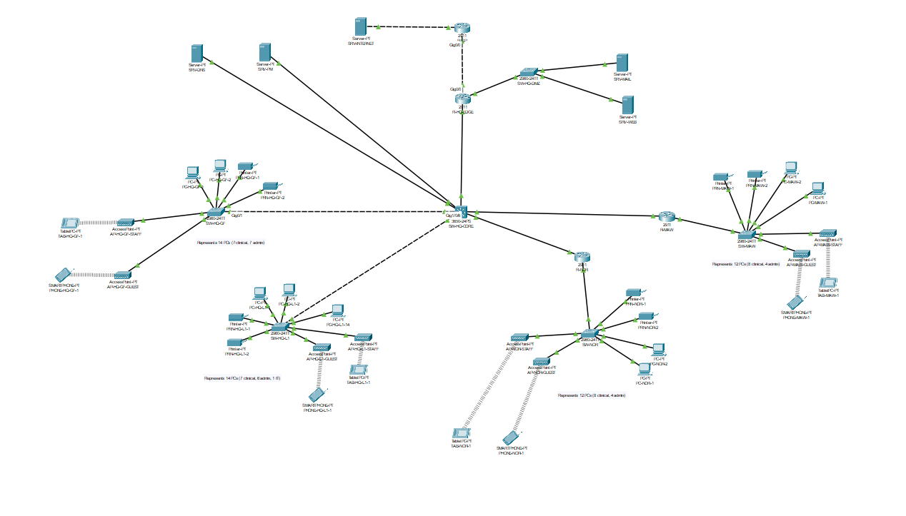
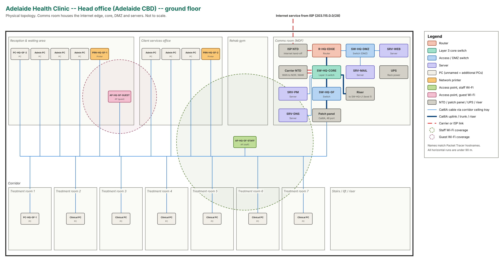
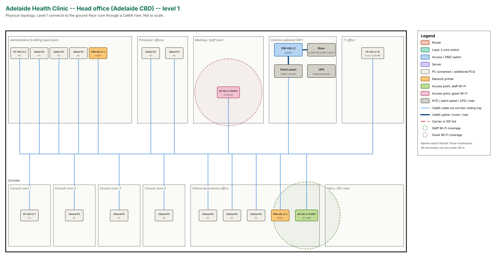
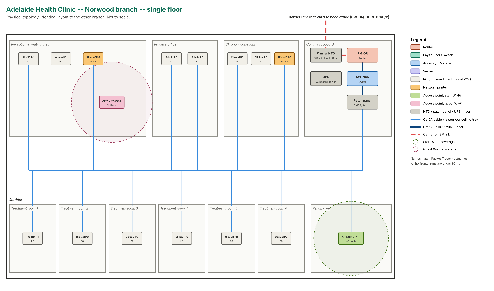
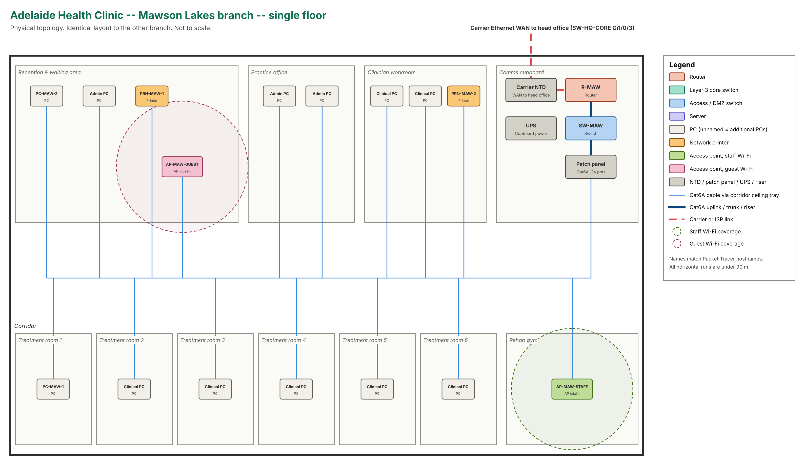

# Adelaide Health Clinic – Secure Multi-Site Network

A three-site corporate network for a fictional allied health practice in Adelaide, designed, built and tested in **Cisco Packet Tracer 8.2.2**. It covers VLAN segmentation, inter-VLAN routing, static routing with summarisation, NAT/PAT, a DMZ, DHCP relay, ACL-based isolation of guest and public-facing traffic, and SSH-only device management.

> University of Adelaide, Computer Networking design project (2026).



## The scenario

| Site | Floors | Role |
|---|---|---|
| Head office, Adelaide CBD | 2 | Internet edge, core, servers, DMZ |
| Norwood branch | 1 | Branch clinic |
| Mawson Lakes branch | 1 | Branch clinic |

- The branches reach the internet only through head office (hub and spoke).
- Patient records sit on an internal server at head office and must be protected from guest Wi-Fi and public-facing systems.
- The public web and mail servers must be reachable from the internet.
- Designed for 52 wired PCs, 36 staff wireless devices and 8 printers. The prototype shows representative devices for each VLAN.

## Design highlights

| Area | Implementation |
|---|---|
| Segmentation | 8 VLANs: clinical, admin, staff Wi-Fi, guest Wi-Fi, printers, servers, DMZ, management. VLAN IDs are identical at every site |
| Switching | 802.1Q trunks with native VLAN 999 and allowed-VLAN lists. Unused ports are shut down and parked in VLAN 998 |
| Inter-VLAN routing | Layer 3 core switch (SVIs) at head office, router-on-a-stick at the branches |
| Routing | Static routing: one summarised /20 per site, plus Null0 discard routes to prevent loops |
| Addressing | `10.0.0.0/18` split into four /20 blocks (one per site, one for infrastructure), with a /21 reserved for a fourth clinic |
| Internet | PAT for all internal users, static NAT for the web (`203.115.0.3`) and mail (`203.115.0.4`) servers |
| DMZ | Public servers on their own router interface. They can reply to inside users but cannot open connections inward |
| DHCP | Central server via `ip helper-address` for staff networks. Guest pools run on the local gateway, so guests never touch an internal server |
| Wireless | Separate staff and guest SSIDs per site, each mapped to its own VLAN |
| Hardening | SSH v2 with a local user, restricted to the management subnets. Telnet disabled, encrypted secrets |

## Security policy

| From ↓ / To → | Staff | Guest | Printers | Servers | DMZ | Mgmt | Internet |
|---|---|---|---|---|---|---|---|
| Staff | ✓ | × | ✓ | ✓ | ✓ | × | ✓ |
| Guest | × | ✓ | × | × | × | × | ✓ |
| DMZ | replies | × | replies | replies | ✓ | × | ✓ |
| Management | × | × | ✓ | ✓ | ✓ | ✓ | ✓ |
| Internet | × | × | × | × | web/mail | × | – |

ICMP is permitted everywhere so that connectivity can be tested end to end. A production network would restrict it. ACL details are in [`docs/security-design.md`](docs/security-design.md).

## Testing

Connectivity and security were verified after every stage. Selected evidence is in [`tests/`](tests):

| Test | Result |
|---|---|
| Branch PCs → head office PC, branch ↔ branch, router ↔ router | ✓ pings succeed |
| Staff PC → internal server (HTTP) | ✓ allowed |
| Guest phone → internal server (HTTP) | × blocked |
| DMZ web server → internal server (HTTP) | × blocked |
| Internet → company website on its public address | ✓ allowed |
| Internet → web on the mail server | × blocked |
| Staff PC → telnet to network devices | × blocked |
| IT PC (management VLAN) → SSH to core and branch router | ✓ allowed |

## Physical design

Floor plans for each site show device placement, cable runs and Wi-Fi coverage:

| Head office, ground floor | Head office, level 1 |
|---|---|
|  |  |
| **Norwood** | **Mawson Lakes** |
|  |  |

## Repository contents

```
diagrams/       logical topology and four floor plans
configs/        running configurations (passwords and secrets removed)
tests/          ping, ACL and SSH test screenshots
docs/           IP addressing plan and security design
packet-tracer/  the .pkt file (open with Cisco Packet Tracer 8.2.2)
```

## Limitations and next steps

- **Single points of failure:** one internet service, one edge router and one core switch. Next steps would be a backup WAN/internet service, an off-site replica of the patient system, and OSPF for automatic failover.
- **Router ACLs are stateless.** A next-generation firewall would add stateful inspection and intrusion prevention.
- **Packet Tracer's access point is limited** to one SSID and pre-shared keys. Production would use WPA3-Enterprise with 802.1X/RADIUS and a wireless LAN controller.
- **Further hardening:** port security, DHCP snooping, dynamic ARP inspection and central logging.

## Tools

Cisco Packet Tracer 8.2.2 · Cisco IOS CLI · draw.io (floor plans)
